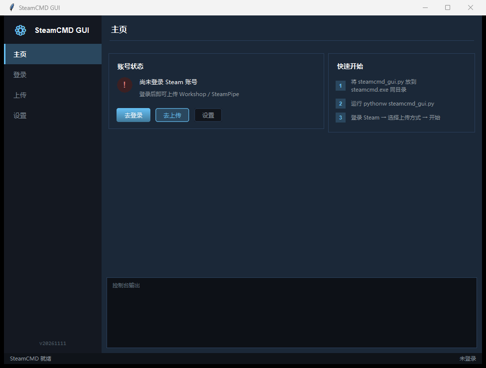
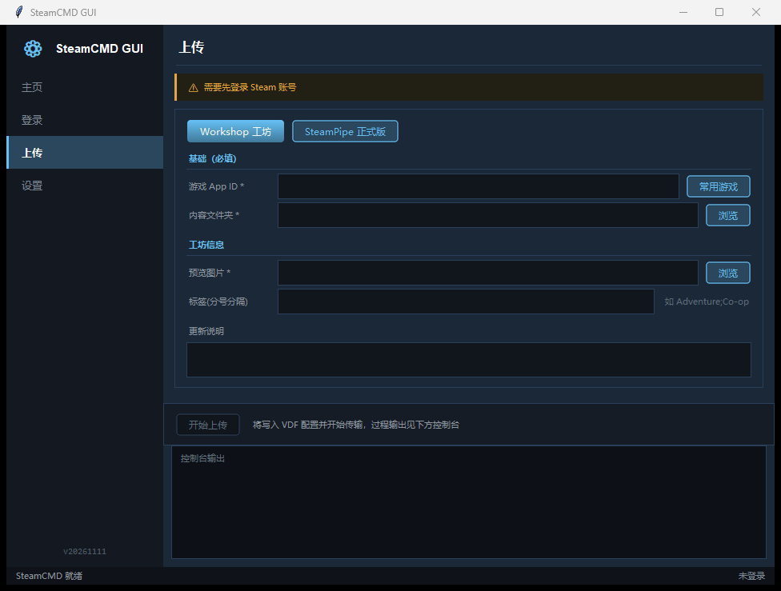
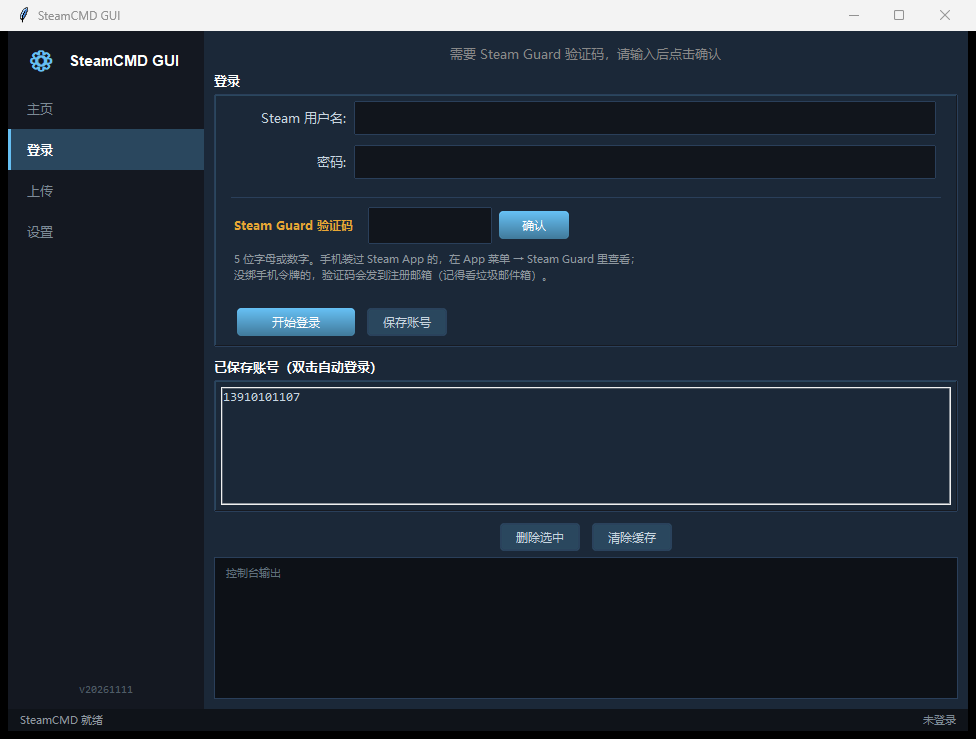
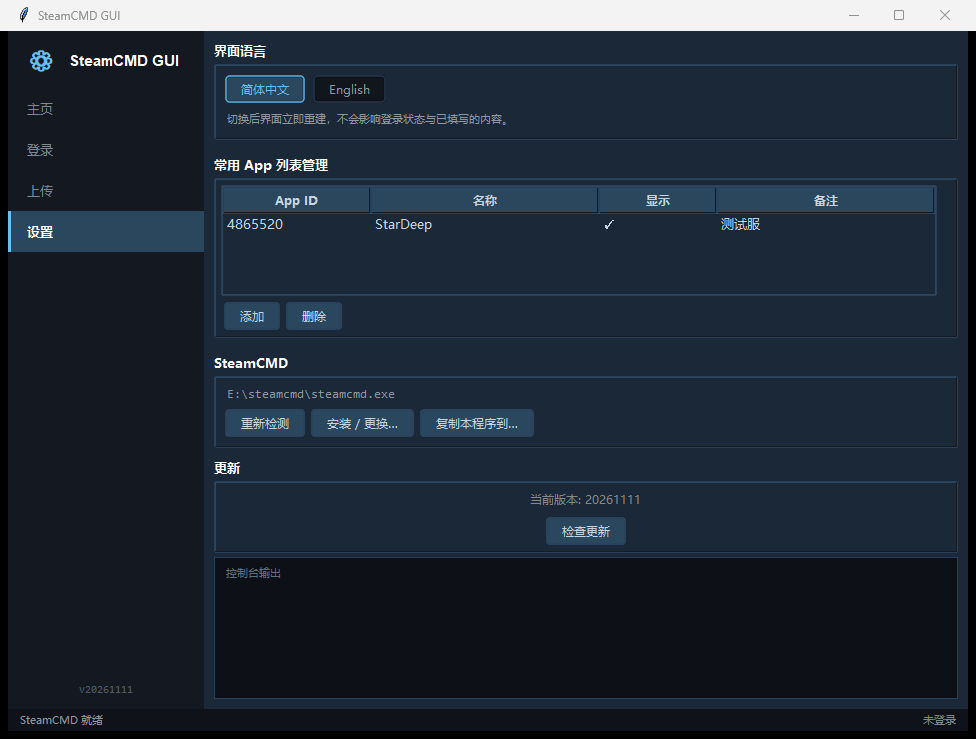
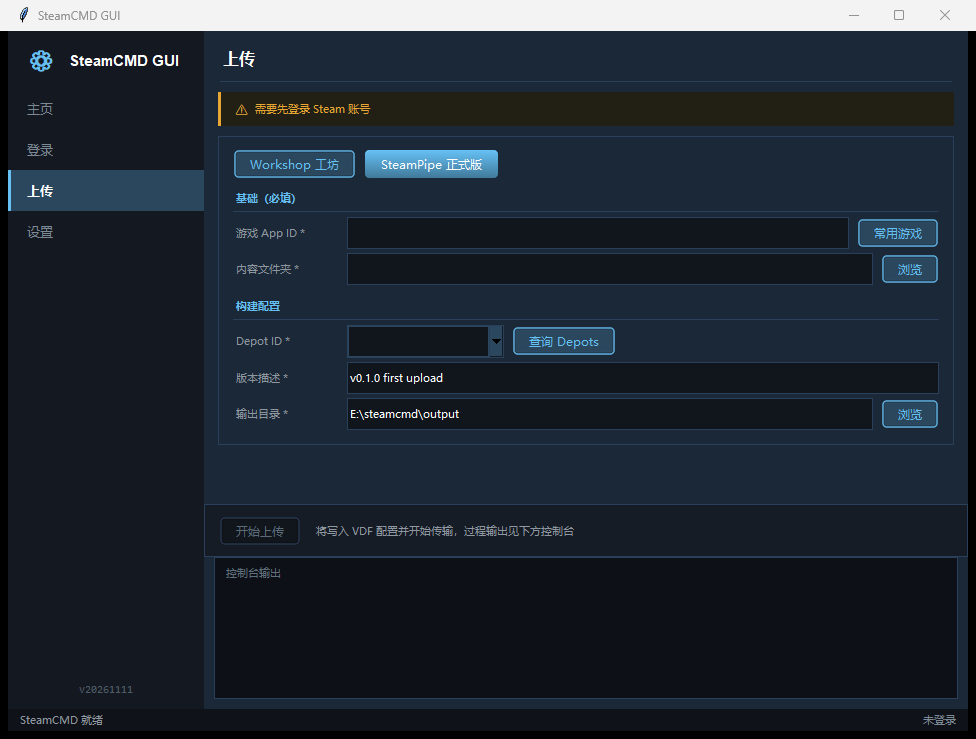

# SteamCMD GUI


> Windows 上的 SteamCMD 图形界面：单文件 Python，不依赖任何第三方 GUI 库。
> 登录、上传工坊、发正式版、查 Depot —— 全部图形化，不用再背命令行。

两种拿法：**下载打包好的 exe 双击就能用**（不用装 Python），或者直接拿走 `steamcmd_gui.py` 单文件自己跑。

---

## 下载

| 版本 | 怎么拿 | 需要什么 |
| --- | --- | --- |
| **exe 版（推荐）** | [**→ 下载最新版 `SteamCMD_GUI.exe`**](https://github.com/HYClub/SteamCMD_GUI/releases/latest) | Windows 10 / 11，**不需要 Python**、不需要命令行，双击即用 |
| **py 版** | 仓库里的 [`steamcmd_gui.py`](steamcmd_gui.py) | Python 3.8+（Windows 版自带 tkinter），一个文件拷走就能跑 |

exe 是 PyInstaller 打包的单文件程序，体积 27 MB 左右。首次启动要解压到临时目录，会比 py 版慢几秒，
之后正常使用。**如果杀毒软件报毒，是 PyInstaller 单文件程序的常见误报**，加信任即可，也可以改用 py 版自己跑。

---

## 为什么还要一个 SteamCMD GUI

SteamCMD 是命令行工具，上传创意工坊要手写 `workshop_build_item` 的 VDF，发正式版要拼
`app_build.vdf` / `depot_build.vdf`，出错提示全是英文堆栈。这个工具把整条链路收进一个窗口：

- 登录状态、Guard 验证码、多账号 —— 点两下就完事
- 上传配置做成表单，VDF 自动生成，不用记字段名
- SteamCMD 没装？程序里直接下载、解压、初始化，进度就显示在主页上

## 功能

| 模块 | 说明 |
| --- | --- |
| **Steam 登录** | 用户名 / 密码 + Steam Guard；凭据用 Windows DPAPI 加密落盘，支持多账号快速切换 |
| **Workshop 工坊上传** | 预览图、标签、可见性、更新说明 → 自动生成 VDF 并执行 `workshop_build_item` |
| **SteamPipe 正式版** | 自动生成 `app_build.vdf` / `depot_build.vdf`，执行 `+run_app_build` |
| **Depot 查询** | `app_info_print` 拉取 Depot 列表，下拉直接选，不用手抄 ID |
| **实时控制台** | SteamCMD 原始输出实时回显 + 上传进度条 |
| **常用 App 列表** | 管理 App ID / 备注，填表时一键带入 |
| **中英双语** | 设置页一键切换中文 / English，界面立即重建，登录态和已填内容都会保留 |
| **安装引导** | 检测不到 `steamcmd.exe` 时弹出说明：官方下载地址、文档，可一键下载并安装到指定目录（下载 → 解压 → 首次初始化 → 复制本程序）|
| **一键迁移** | 已装过 SteamCMD？把本程序（可带配置）复制到 `steamcmd.exe` 同目录并重启 |
| **自更新** | py 版启动时后台比对仓库版本，有新版本在顶部提示；exe 版请到 Releases 下载新版覆盖 |
| **安全退出** | 关窗自动终止 SteamCMD 子进程，不留后台僵尸 |

## 快速开始

**exe 版**：双击 `SteamCMD_GUI.exe`，没了。

**py 版**：机器上有 Python 3.8+（Windows 版自带 tkinter）即可。

```bat
pythonw steamcmd_gui.py
```

用 `pythonw` 启动不会留黑框窗口；用 `python` 也能跑，只是会多挂一个控制台。

两种版本都建议放在 `steamcmd.exe` 同目录，程序启动时会自己找到它。

首次启动如果没找到 `steamcmd.exe`，会弹出引导框：

- **已经装过** → 点「自动复制过去…」，选中 `steamcmd.exe` 所在目录，程序自己复制并重启
- **没装过** → 点「下载 ▾ → 下载并安装到指定目录…」，选个位置，剩下全自动

装好之后也可以在「设置 → SteamCMD」里随时重新检测或更换安装位置。

## 截图

| 主页 | Workshop 工坊上传 |
| :---: | :---: |
|  |  |
| **登录 / Steam Guard** | **设置** |
|  |  |
| **SteamPipe 正式版** | |
|  | |

## 目录结构

```
SteamCMD_GUI/
├─ steamcmd_gui.py     # 全部逻辑都在这一个文件里
├─ steamcmd_gui.ico    # 程序图标（打包 exe 时用）
├─ README.md
└─ screenshots/        # 界面截图
```

## 技术要点

- **单文件** —— 只有一个 `steamcmd_gui.py`，无第三方 GUI 依赖，拷走就能用
- **真终端** —— 用 ConPTY（pywinpty）包 SteamCMD，而不是管道读 stdout，交互式提示与彩色输出不会丢
- **凭据加密** —— 密码用 Win32 DPAPI（`CryptProtectData`）按当前用户加密，换台机器读不出来
- **中英双语** —— 中文原文直接当 key 的翻译表，切换时整棵树重建；漏翻只会回落中文，不会崩
- **自绘控件** —— tkinter 原生按钮没有圆角，用 Canvas + 4× 超采样渲染出 Steam 风格的圆角按钮与细滚动条
- **零配置启动** —— 缺 `pywinpty` 自动 `pip install`；找不到 SteamCMD 自动引导安装

## 常见问题

**提示缺少 pywinpty？**
程序会自动装；失败的话手动执行 `pip install pywinpty`。

**首次初始化卡在「正在拉取运行环境」很久？**
正常。首次运行 SteamCMD 要下载约 300 MB 运行环境，耗时 1–5 分钟，取决于网络。

**Steam Guard 验证码在哪儿看？**
5 位字母或数字。手机装过 Steam App 的在 **App 菜单 → Steam Guard** 里；没绑手机令牌的会发到注册邮箱。

---

*仅供个人上传内容使用，与 Valve 官方无关。*
